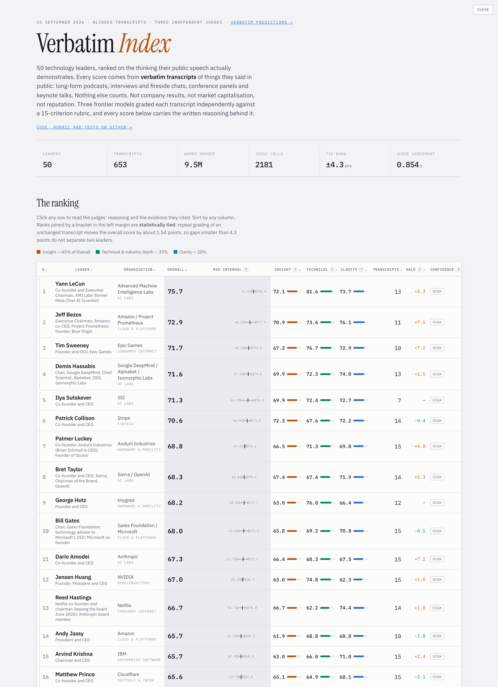

# Verbatim Index

Ranks well-known technology leaders on the thinking their public speech
demonstrates, scored **only** from transcripts of interviews, podcasts and
keynotes. Nothing about company performance, market value or reputation enters
a score.

Live leaderboard: **[verbatim-index.tonygwu.com](https://verbatim-index.tonygwu.com)**

[](https://verbatim-index.tonygwu.com)

A sibling product, **Verbatim Predictions**, asks who in tech or finance is best
at predicting the future:
**[verbatim-predictions.tonygwu.com](https://verbatim-predictions.tonygwu.com)**.
It collects the falsifiable predictions that leaders made in public. Each one is
quoted word for word from a transcript at a known timestamp, and is accepted only
when two model families agree that it is a prediction. When a prediction's
deadline passes, one model searches the web for what happened and must cite a
source. A separate model, which does not see the outcome, judges how likely the
event looked on the day the words were said. Points compare each call with those
baseline odds, and the page ranks people by Score, their mean points per resolved
prediction. A person with fewer than 3 resolved predictions gets no Score. The
page explains its own limits, among them that the model judging the odds may
remember some outcomes from its training. The design is in `docs/PREDICTIONS.md`
and the scoring rule in `docs/PREDICTIONS-SCORING.md`.

This repository is the code: rubric, pipeline, grading harness and the tests
that guard them (MIT, see `LICENSE`). The transcripts, raw judge output and
per-leader results live in a separate private repository that the pipeline
expects to find cloned at `data/`. Without it the scripts still import and the
test suites run, but there is nothing to grade or render.

```bash
git clone https://github.com/tonygwu/verbatim-index.git && cd verbatim-index
uv venv --python 3.12 .venv && uv pip install --python .venv/bin/python -r requirements.txt
.venv/bin/python scripts/test_grade_harness.py     # pure checks, no model calls
.venv/bin/python scripts/test_blinding.py
```

## Private data and experiments

Production has one live private checkout, managed by its production owner.
Experiment agents can opt into independent private clones and push their own branches.
Use the dry-run migration and setup commands in [docs/DATA-CLONE-WORKFLOW.md](docs/DATA-CLONE-WORKFLOW.md).
The migration preserves shared uncommitted files and copies only explicitly owned runs.
Both `data` and `.data-clones` remain ignored by this public repository.

Production publication requires an explicit live source and full data revision:

```bash
bash scripts/deploy.sh --production-data ../data \
  --data-revision "$(git -C ../data rev-parse HEAD)" --dry-run
```

Use `deploy_predictions.sh` with the same arguments for the predictions site.
Only the production owner runs ingestion, withdrawals, production aggregation,
or `--refresh`. Experiment results use unique `data/predictions/_experiments/` directories.

## Status

Both boards are live. Each page states the date it was generated and how many
transcripts it was built from.

**Fetching and grading are separate processes that share only files on disk.**
Fetching is gated by an external rate limit that flickers on and off for hours;
grading is gated by model quota. Chaining them meant one stall blocked the other
and a grading failure looked like a fetch failure.

```bash
bash scripts/status.sh                # where both halves stand, and what to run next
```

### Fetching: a daemon that just accumulates transcripts

```bash
nohup bash scripts/fetch_loop.sh > data/logs/fetch_loop.log 2>&1 &
```

Runs on its own loop. Each cycle probes the endpoint, fetches whatever it can,
and doubles its own sleep when blocked or when a pass gains nothing, up to a
ceiling (`BASE_SLEEP` and `MAX_SLEEP` in `scripts/fetch_loop.sh`). While YouTube
is refusing requests, the loop probes again every minute and resumes as soon as
a probe passes. It returns to the base cadence as soon as a pass gains
transcripts. Exits by itself once every leader has `TARGET` gradeable
transcripts, or after `BARREN_LIMIT` passes in a row gain nothing. Safe to kill
and restart at any point, since completed transcripts are skipped. It knows
nothing about grading.

### Grading and rendering: run when there is enough data

```bash
STAGES="3 4" bash scripts/run_pipeline.sh              # qa + blind
STAGES="5"   WORKERS=10 bash scripts/run_pipeline.sh   # blinded grading, published score
STAGES="6"   WORKERS=10 bash scripts/run_pipeline.sh   # unblinded, halo measurement only
STAGES="7 8" bash scripts/run_pipeline.sh              # aggregate + render
```

Each is independently resumable and skips completed judge calls, so grading can
run on a partial corpus and be re-run later as more transcripts arrive.

## What is scored

Three dimensions, each 1-100, supported by 15 sub-criteria that a judge may
mark *not observed* when the format gave no chance to demonstrate them.

| Dimension | Weight | Question |
| --- | --- | --- |
| Insight | 45% | Are the points non-obvious, load-bearing, honestly held? |
| Technical depth | 35% | Do they understand mechanism, magnitudes, terrain? |
| Clarity | 20% | Can a listener reconstruct their model? |

Clarity is deliberately the smallest weight. The rubric explicitly refuses to
reward fluency or confident delivery, because a polished non-answer is the
failure mode it exists to catch. Full definitions and anchors are in
`.agents/skills/leader-transcript-grader/RUBRIC.md`.

## How it runs

```bash
scripts/run_pipeline.sh                    # all eight stages
STAGES="7 8" scripts/run_pipeline.sh       # just re-aggregate and re-render
```

| Stage | Does |
| --- | --- |
| 1 | ranked candidates to fetch manifest, aliases, repairs |
| 2 | fetch verbatim captions, paced and circuit-broken |
| 3 | quality gates: garble, ASR loops, speech rate, name density |
| 4 | repair ASR errors, then blind and un-blind identity |
| 5 | **blinded** grading, every transcript (published score) |
| 6 | **unblinded** grading, 2 per leader (halo measurement only) |
| 7 | aggregate with per-judge normalisation |
| 8 | render `site/index.html` |

Three judges grade independently: **Claude Fable 5.1**, **OpenAI GPT-6 Astra**
and **Google Gemini 3.8 Flash**, each at its highest reasoning setting. Model
identity is asserted from each call's telemetry, never assumed. The grading
daemon `scripts/grade_loop.sh` runs all three for the published score. Stage 5
of `run_pipeline.sh` still names only Fable and Astra. The panel grew to three
judges partway through the corpus, so not every transcript carries all three
grades, and the live page says how many do.

## What the calibration says

Five repeat gradings of one unchanged transcript per judge, `data/logs/calibration.json`:

- Within-judge standard deviation of the composite: **1.29** (Fable), **1.78** (Astra),
  **1.64** (Gemini).
- So differences under about **4 points are ties**. The leaderboard brackets them.
- Coverage and venue-difficulty judgements were identical across all repeats.
- Astra runs **7.5 points more generous** than Fable, which is 4.9x the noise.
  That is an offset, not disagreement, so each judge's distribution is recentred
  on the pooled one before averaging.

## Known limits

- **Blinding removes the name, not the identity.** The judges named the speaker
  from products and context in 100% of the fixture's blinded runs. Stripping
  product names would gut the dimension being measured. The leakage rate is
  measured and published rather than hidden, and the *Halo* column reports what
  changes when the judges are told who they are.
- **Captions carry no speaker labels.** Judges separate subject from interviewer
  by context and report their confidence and the subject's share of the talking.
- **Venue format is corrected for; venue difficulty is not.** The published
  score subtracts what the format of an appearance is worth, with the speaker
  held fixed, so a keynote and a long-form podcast stand on the same footing
  (`venue_effects()` in `scripts/aggregate.py`). How hard the conversation
  itself was is reported, never corrected for. A leader who only does friendly
  interviews scores lower on insight, and adjusting would mean inventing a score
  for a conversation that never happened.
- **Judges are language models.** Three frontier models agreeing is evidence. It
  is not the same as being right.

## Layout

```
.agents/skills/leader-transcript-grader/   rubric, skill, output schema
.agents/skills/polite-bulk-fetching/       rate-limit discipline, researched
scripts/                                   pipeline, one stage per file
data/                                      PRIVATE repo, cloned here, gitignored
  roster/final.json                          the roster, exclusions and withdrawals
  sources/discovered.json                    ranked candidate sources
  logs/                                      QA, calibration, errors, block state
  transcripts*/ grades/ results.json         working data and judge output
site/index.html                            the leaderboard, rendered, gitignored
```

Transcripts under `data/` are working data for the analysis and are not
published. The public page carries only short attributed evidence quotes,
capped at 25 words each and enforced by the grader's validator, with a link
back to each source.

Judge calls are routed across the operator's Claude subscriptions by
[llm-quota-router](https://github.com/tonygwu/llm-quota-router), which
`grade.py` imports as a library. With one account it simply reports one account.
